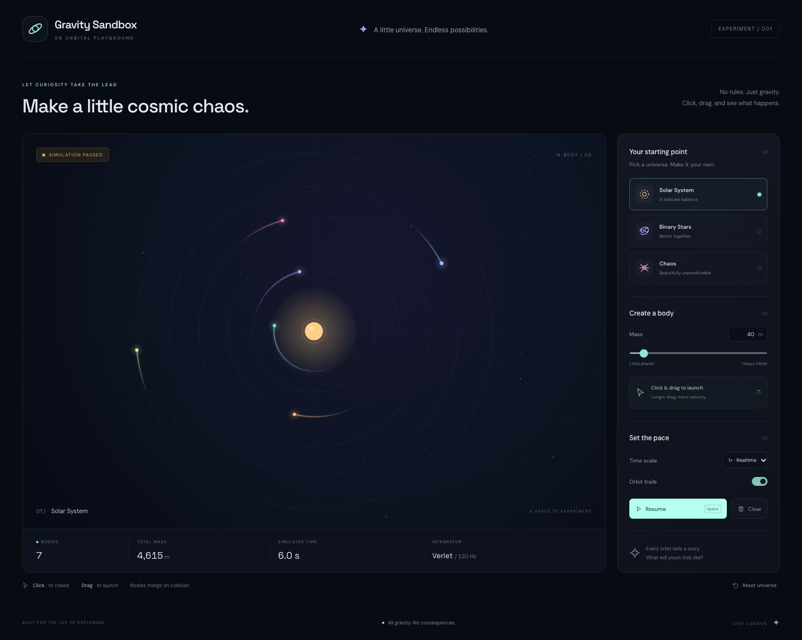

# Gravity Sandbox

Небольшая гравитационная песочница: TypeScript + Vite + Canvas 2D, без React и бэкенда.



## Запуск

Требуется Node.js **22.12+ (ветка 22) или 24+** и npm.

```sh
npm ci
npx playwright install chromium
npm run dev
```

Откройте http://127.0.0.1:5173. Для размещения статического сайта:
`npm run build`, затем публикуйте содержимое `dist/`. Локальный просмотр сборки:
`npm run preview`. Шрифты включены в сборку: внешние сервисы приложению не нужны.

## Управление

- **Клик / касание** — создать неподвижное тело.
- **Зажать, потянуть, отпустить** — создать тело в начальной точке жеста и задать
  скорость по направлению стрелки. Длина жеста определяет скорость.
- **Mass** — масса следующего тела (1–500); настраивается числом или ползунком.
- **Pause / Resume**, **Space** — остановить / продолжить; редактирование работает на паузе.
- **Time scale** — 0.25×–4×; **Orbit trails** — включить / убрать следы.
- **Clear** — очистить тела, следы и время; **Reset universe / R** — восстановить пресет.
- **Escape** — отменить незавершённый жест.
- **Solar System**, **Binary Stars**, **Chaos** — воспроизводимые начальные сцены.

Пресеты и очистка сохраняют состояние паузы. На телефоне панель находится под сценой.

## Физика и ограничения

Смягчённое попарное гравитационное взаимодействие, velocity Verlet, фиксированный
шаг 1/120 секунды. Масса определяет ускорение других тел. При перекрытии тела
сливаются с сохранением суммарной массы, положения центра масс и линейного импульса.
Энергия при неупругом столкновении **не** сохраняется.

Это демонстрация, а не астрономический расчёт: условные единицы, нет границ мира,
панорамирования, релятивистских эффектов или непрерывного детектора столкновений.
Тела могут улететь за экран; пресет/Reset возвращает сцену. Максимум 160 тел,
180 точек следа на тело, скорость запуска ограничена 300 условными единицами/с.
Физика O(n²). После фоновой вкладки большой backlog времени отбрасывается:
стабильность важнее синхронизации с реальными часами.

## Проверки

```sh
npm test                 # unit-тесты физики и пресетов
npm run test:e2e         # настоящий Chromium через Playwright
npm run build           # строгий TypeScript + production Vite build
npm run format:check     # Prettier
npm audit
```

Playwright сам запускает Vite на 5173 (или использует уже работающий dev-сервер).
Тесты проверяют загрузку и console errors, пресеты, реальную неподвижность Canvas на
паузе, продолжение движения, создание/массу/скорость запуска, очистку, множитель
времени, отмену жеста, лимит тел, resize и мобильное касание. Управляемые часы
позволяют воспроизводить временные проверки без ожидания реальных секунд.

Скриншоты: [desktop](artifacts/gravity-desktop.png),
[mobile](artifacts/gravity-mobile.png),
[Binary Stars — отдельный MCP browser](artifacts/gravity-binary-live.png).
Первые два пересоздаются тестами. При падении сохраняются screenshot и trace в
`test-results/`; открыть trace: `npx playwright show-trace <path-to-trace.zip>`.

Фактические результаты, окружение и границы проверки: [docs/verification.md](docs/verification.md).
Независимое ревью и риски: [docs/review.md](docs/review.md).

## Структура

| Файл              | Ответственность                              |
| ----------------- | -------------------------------------------- |
| `src/physics.ts`  | Модель тела, интегратор, столкновения, часы  |
| `src/presets.ts`  | Детерминированные сцены                      |
| `src/renderer.ts` | Canvas, координаты, звёзды, свечение и следы |
| `src/main.ts`     | DOM, события, управление симуляцией          |
| `src/style.css`   | Адаптивная панель и оформление               |
| `tests/`          | Vitest + Playwright                          |

## Переиспользуемый Git skill

Путь: [`.opencode/skills/agent-git-workflow/SKILL.md`](.opencode/skills/agent-git-workflow/SKILL.md).
Это официальный project-level формат [OpenCode V2 skills](https://opencode.ai/v2/docs/skills).

В следующем проекте скопируйте папку `agent-git-workflow` в `.opencode/skills/` и
попросите агента: **«Используй @agent-git-workflow для этой задачи»**. Агент загружает
его через `skill` с ID `agent-git-workflow`. Рабочая директория сессии должна быть
в проекте. В этой сессии skill действительно обнаружен и успешно загружен штатным
инструментом OpenCode; см. [проверку skill](docs/skill-validation.md).

Для глобальной установки (выполните самостоятельно, не перезаписывая свой skill):

```sh
mkdir -p ~/.config/opencode/skills/agent-git-workflow
cp -n .opencode/skills/agent-git-workflow/SKILL.md ~/.config/opencode/skills/agent-git-workflow/SKILL.md
```

Project-level skill с тем же ID имеет приоритет над глобальным. Skill — инструкции
агенту, а не техническая замена branch protection или Git hooks.

## Git

Рабочая ветка — `feature/gravity-sandbox`, база — `develop`. Remote был пуст;
`main` и `develop` созданы локально от минимального начального коммита. Push, merge,
rebase и переписывание истории не выполнялись. Интеграция — отдельный будущий PR в
`develop`, после явного разрешения на отправку кода.
